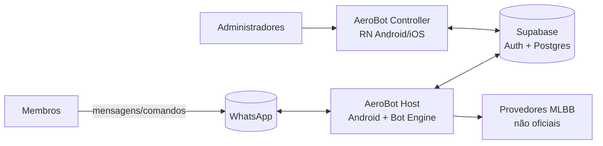
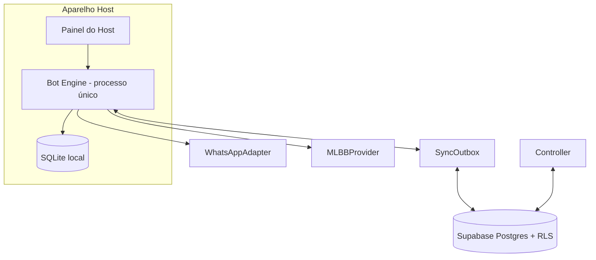

# Visão do sistema

Status: **Proposta / Pendente** (validar após PoC do Host — ADR-0003).

## C4 — Contexto

## C4 — Contêineres

Fonte da verdade operacional: **SQLite do Host**. Postgres guarda cópia de leitura (dashboards), fila de comandos e auditoria replicada. Sessão WhatsApp fica só no Host.

## Fluxo de uma mensagem

1. Adapter recebe evento bruto → normaliza em `InboundMessage` (id estável, remetente, grupo).
2. Deduplicação por `(plataforma, message_id)`.
3. Resolve identidade (WhatsAppIdentity → Member) e rota do grupo.
4. Se começa com prefixo: CommandRegistry → validação → autorização → rota/limite → handler → resposta enfileirada → auditoria.
5. Sempre: ActivityService registra contagem; ScoringService decide XP (antiflood) e grava lançamento.
6. Eventos de domínio vão à outbox; NotificationGateway agrega e envia.

## Estados de comando remoto (Controller → Host)

`pendente → recebido → em execução → concluído | falhou | expirou | cancelado`. Só o Host escreve `concluído`.

## Ciclo de vida de notificação

`registrado → enfileirado → enviado → confirmado | falha de entrega`, com chave de idempotência por (evento, destino).
